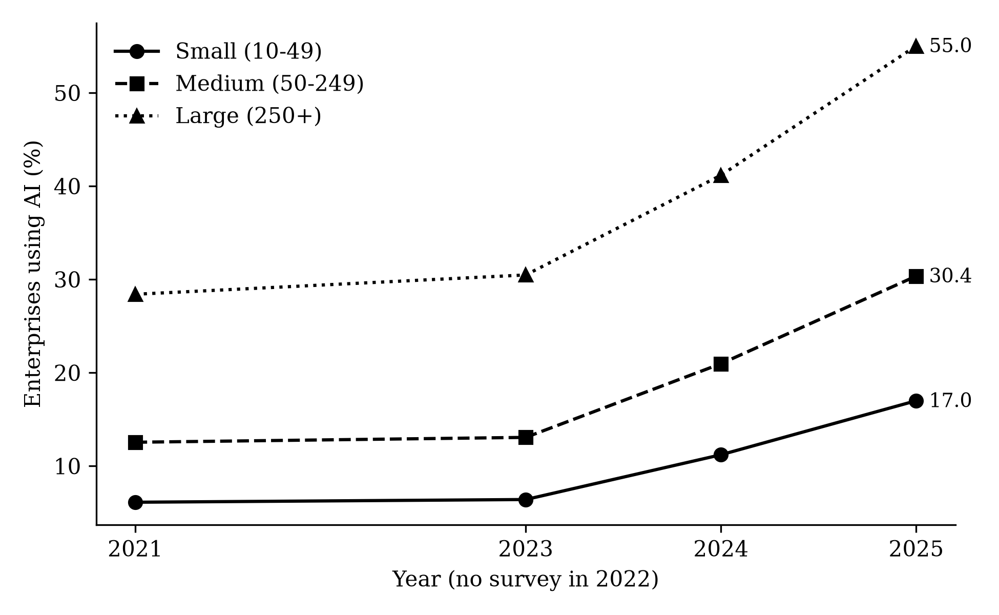

# AI adoption, SME productivity and employment in the EU

Panel analysis of whether higher AI adoption among small and medium-sized enterprises goes together with higher labour productivity and employment, across the 27 EU member states from 2021 to 2024. Azerbaijan is the policy case.

**Authors:** Tahmina Zaman Mitoshi (University of Warsaw, [ORCID](https://orcid.org/0009-0000-9928-7774)) and Md. Rezaur Rahman
**Paper:** *AI Adoption, SME Productivity and Employment in the European Union: Evidence and Policy Lessons for Azerbaijan.* 2nd International Conference "New Generation Economy: Challenges and Prospects", Economic Scientific Research Institute (ESRI), Baku, 16 October 2026.

## Research question

Is higher AI adoption among SMEs associated with higher real labour productivity and employment in those enterprises across EU-27 member states between 2021 and 2024? The protocol was fixed on 10 October 2026 before the analysis ran ([`docs/research_protocol_2026-10-10.docx`](docs/research_protocol_2026-10-10.docx)). The claim is association, not causation.

## Main results

**The AI gap between small and large firms is wide and growing.** EU27 share of enterprises using at least one AI technology:

| Year | Small (10–49) | Medium (50–249) | Large (250+) | Gap, large minus small (pp) |
|---|---|---|---|---|
| 2021 | 6.1% | 12.6% | 28.4% | 22.3 |
| 2023 | 6.4% | 13.1% | 30.5% | 24.1 |
| 2024 | 11.2% | 21.0% | 41.2% | 30.0 |
| 2025 | 17.0% | 30.4% | 55.0% | 38.0 |

**No clear link to productivity or employment yet.** In two-way fixed effects models, a 1 percentage point rise in a country's AI adoption rate is not significantly associated with real labour productivity in any size class. For small firms, the employment coefficient is negative (−0.46% per point) but only marginal (p = 0.09; wild bootstrap p = 0.07), and it disappears when 2024 is dropped (p = 0.87) or France and Sweden are excluded (p = 0.27). Within-country changes in AI use over 2021–2024 are small (mean +5.9 points for small firms), so three years of data leave little variation to work with.



## Data

Panel of 27 countries × 3 size classes × 3 years (243 rows) built from four Eurostat datasets, downloaded through the SDMX 3.0 API on 10 October 2026:

| Variable | Dataset | Indicator |
|---|---|---|
| AI adoption (% of enterprises) | `isoc_eb_ai` | E_AI_TANY |
| Basic digital intensity (% of enterprises) | `isoc_e_dii` | E_DI3_GELO |
| Persons employed, value added | `sbs_sc_ovw` | EMP_NR, AV_MEUR |
| Real GDP growth, price deflator | `nama_10_gdp` | CLV_PCH_PRE, PD20_EUR |

Coverage: industry, construction and market services (NACE B to S, excluding public administration). The SBS classes 10–19 and 20–49 are summed to match the survey's 10–49 class.

## Method

```
y_it = b · AI_it + g1 · DII_it + g2 · GDPgrowth_it + country FE + year FE + e_it
```

- `y` = log real labour productivity, or log persons employed
- Estimated separately for small, medium and large firms
- Standard errors clustered by country. Because there are only 27 clusters, p-values also come from a wild cluster bootstrap (restricted residuals, Webb weights, 9,999 replications, seed 20261010)
- Six robustness checks: 2021 and 2023 only; excluding France and Sweden (series breaks); without digital intensity; leave one country out; without GDP growth; no controls

## How to run

Requires Python 3.10 or newer.

```bash
pip install -r 05_analysis/requirements.txt
cd 05_analysis
python 01_clean_data.py          # raw Eurostat files -> 04_data_clean/
python 02_analysis.py            # descriptives, regressions, figures -> output/
python 03_inference_checks.py    # wild bootstrap and sensitivity checks -> output/
```

The scripts read `03_data_raw` without changing it. Rerunning reproduces every table in `05_analysis/output` (checked with statsmodels 0.15).

## Repository structure

```
03_data_raw/         Eurostat downloads, unchanged
04_data_clean/       clean panel and cleaning report (created by 01_clean_data.py)
05_analysis/         three scripts and requirements.txt
05_analysis/output/  tables (CSV), figures (PNG), results and inference reports
docs/                research protocol, decision log, data-source log, literature search log and screening rules
```

The literature search (Scopus, 474 records screened in two stages) is recorded in `docs/search_log.csv` and `docs/screening_rules.csv`. The Scopus export itself is not included, under Scopus terms of use.

## Data source and license

Data © European Union, Eurostat. Reused under the Commission's reuse policy (Decision 2011/833/EU), with the source acknowledged.
Code: MIT License (see `LICENSE`).
